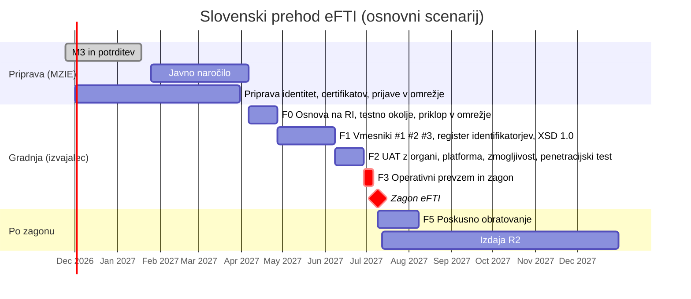

# 10 Časovni načrt implementacije

> **Zahteva:** TS javnega naročila, točka 2.4: faze razvoja, pilotnega uvajanja, testiranja in produkcijskega zagona
>
> **Viri:** Uredba (EU) 2020/1056, čl. 5(1) in 17; IU 2024/1942 (UL L 20. 12. 2024); časovnica integracijskega omrežja eFTI4LIVE (TG1.5/TG2.3, 9. 11. 2026 in Praga, 19. 11. 2026); načrt izdaj RI (TG2.2, Praga); načrt XSD (CTG Data Model & Interfaces, Praga); implementacijski načrt Slovenije (20. 5. 2026); pogodba za M3
>
> **Status:** osnutek v0.2 (19. 11. 2026), za interni pregled

## 10.1 Fiksni datumi

| Datum | Dogodek | Vir | Status |
|---|---|---|---|
| **9. 7. 2027** | Pristojni organi morajo sprejemati informacije v elektronski obliki (zagon eFTI) | čl. 5(1) Uredbe (EU) 2020/1056: 30 mesecev po začetku veljavnosti prvega izvedbenega ali delegiranega akta; IU 2024/1942 objavljena 20. 12. 2024, velja od 9. 1. 2025 | **preverjeno v besedilu aktov** |
| 21. 8. 2027 | Prvo poročanje DČ Komisiji o številu dostopov pristojnih organov | čl. 17 Uredbe (EU) 2020/1056 | preverjeno |
| 31. 10. 2026 | Zaključek specifikacij eDelivery (npr. pravila poimenovanja) | TG2.3 (Praga) | projektni dogovor |
| 31. 12. 2026 | Zaključek tehničnih specifikacij za izdajo ob zagonu (iskanje, register Unije) | TG2.3 (Praga) | projektni dogovor |
| 31. 3. 2027 | Zaključek operativnih specifikacij (služba za pomoč, vzdrževalna okna) | TG2.3 (Praga) | projektni dogovor |
| 24. 11. 2026 | Mejnik M2 (analiza stanja, izbira variante) | pogodba za M3 | pogodbeno |
| 24. 12. 2026 | Mejnik M3 (ta TS); potrditev MZIE v 15 delovnih dneh | pogodba za M3 | pogodbeno |

## 10.2 Okvir EU: kaj pričakuje integracijsko omrežje

| Obdobje | Integracijsko omrežje in specifikacije | Referenčna implementacija (RI) |
|---|---|---|
| nov.–dec. 2026 | načrtovanje integracije prvega vala (10+ DČ); zamrznitev specifikacij 31. 12. | v0.9 (zadnja izdaja eFTI4EU) |
| jan. 2027 | integracija prvega vala; posodobitev XSD | poenostavljena lokalna namestitev |
| feb. 2027 | začetek testiranja v integracijskem omrežju (tehnična interoperabilnost, funkcionalni testi z organi) | vzdrževanje; Launchpad (feb.–jun.) |
| mar. 2027 | stalno integracijsko omrežje; Testfest 4; načrt paketa za drugi val | posodobitev sheme in protokola (XSD) |
| apr. 2027 | paket za priklop drugega vala DČ; **produkcijski sistemi pripravljeni, poskusni zagon operativnih procesov** (npr. služba za pomoč); končna posodobitev XSD 1.0 | v0.97; SML/SMP (apr.–maj) |
| maj 2027 | implementacija XSD 1.0 | v1.x |
| jun. 2027 | zadnje posodobitve in preklop v produkcijo; končni test XSD 1.0; test podpore več različicam XSD | — |
| 9. 7. 2027 | zagon | — |
| po zagonu | 6-mesečni cikel izdaj (delegirani akt + XSD) | vzdrževanje |

## 10.3 Kritična pot: javno naročilo za gradnjo prehoda

Implementacijski načrt Slovenije (20. 5. 2026) predvideva objavo naročila za gradnjo prehoda novembra 2026, podpis pogodbe januarja–februarja 2027 in gradnjo februarja–julija 2027. Ker je ta TS (M3) tehnična specifikacija tega naročila in je rok M3 24. 12. 2026, objava pred januarjem 2027 ni mogoča. Izračun (praznike RS upošteva; trajanje pregleda ponudb in priprave razpisne dokumentacije je **[predpostavka]**):

| Korak | Osnovni scenarij | Pospešeni scenarij |
|---|---|---|
| Oddaja M3 | 24. 12. 2026 | 11. 12. 2026 (predčasna oddaja) [predlog] |
| Potrditev MZIE | 18. 1. 2027 (15 delovnih dni) | 18. 12. 2026 (5 delovnih dni) [predlog] |
| Objava naročila | 25. 1. 2027 | 4. 1. 2027 |
| Rok za ponudbe | 24. 2. 2027 (30 dni) | 19. 1. 2027 (15 dni ob predhodnem informativnem obvestilu) |
| Odločitev o oddaji (3 tedne pregleda) | 17. 3. 2027 | 9. 2. 2027 |
| Iztek roka za revizijo (10 delovnih dni) | 1. 4. 2027 | 23. 2. 2027 |
| Podpis pogodbe | **~6. 4. 2027** | **~1. 3. 2027** |
| Čas za gradnjo do 9. 7. 2027 | **~13 tednov** | **~18 tednov** |

**Ugotovitev.** Osnovni scenarij izvajalcu pusti približno tri mesece, kar ne zadošča za celoten obseg pogl. 6–9, zamudi pa tudi aprilski »produkcijsko pripravljen« mejnik omrežja. Vložen zahtevek za revizijo bi podpis pogodbe zamaknil dodatno.

**Preveriti:** minimalni rok za prejem ponudb v odprtem postopku nad mejnimi vrednostmi EU po ZJN-3 (Direktiva 2014/24/EU: 35 dni, 30 dni pri elektronski oddaji, 15 dni ob predhodnem informativnem obvestilu) ter rok za zahtevek za revizijo zoper odločitev o oddaji po ZPVPJN (po noveli ZPVPJN-B 10 delovnih dni za vsebino razpisne dokumentacije).

## 10.4 Ukrepi za skrajšanje kritične poti

| Ukrep | Učinek | Kdo | Rok |
|---|---|---|---|
| Objava predhodnega informativnega obvestila (PIN) | rok za ponudbe se lahko skrajša na 15 dni | MZIE | vsaj 35 dni pred objavo naročila: za objavo 4. 1. 2027 najpozneje **30. 11. 2026** |
| Predčasna oddaja M3 in pregled MZIE vzporedno z izdelavo (verzija v0.5 sredi decembra) | objava naročila v začetku januarja | izvajalec M3, MZIE | 11. 12. 2026 |
| Vzporedna priprava razpisne dokumentacije (merila, pogodba, SLA) | ni čakanja po potrditvi TS | MZIE | december 2026 |
| Gradnja na referenčni implementaciji (ADR-0002) | prihranek razvoja vmesnikov #1, #2 in registra identifikatorjev | izvajalec gradnje | od podpisa |
| Zagonski obseg (izdaja R1) in poznejša izdaja R2 (10.5) | manj dela do 9. 7. 2027 | MZIE, izvajalec | v razpisni dokumentaciji |
| Priprava pred podpisom: identifikator prehoda, certifikacijski organ, certifikati za testno okolje, prijava v integracijsko omrežje, sodelovanje v TG2.2 | izvajalec lahko takoj začne integracijo | MZIE | do februarja 2027 |
| Rezervna možnost: skupni ali gostovani prehod z drugo DČ (čl. 2(4) IU 2024/1942 dovoljuje skupno vzpostavitev) | zmanjšanje tveganja nepravočasnega zagona | MZIE | odločitev ob M2 |

## 10.5 Faze in izdaje

| Izdaja | Obseg | Rok |
|---|---|---|
| **R1 (zagon)** | vse zahteve iz pogl. 6 (pravne obveznosti), zahteve pogl. 7 za vmesnike #1, #2 in #3, register identifikatorjev, preverjanje certifikacijskega statusa (vsaj ročno vodeni register platform), dnevniki in revizijska sled, varnost (8.5), služba za pomoč (čl. 12), prevzemne faze F1–F4 | 9. 7. 2027 |
| **R2** | SI-GATE-FR-213 (razširjeni identifikatorji, ko bo sprejeta sprememba IU), SI-GATE-FR-233 (API registra dovoljenj), SI-GATE-FR-271 v samodejni obliki (sinhronizacija z Unijskim referenčnim seznamom), SI-GATE-NFR-281 (okolje TCT pri prehodu), SI-GATE-NFR-282 (politika PRA, če jo MZIE sprejme), SI-GATE-FR-253 (izbira različice sklopa podatkov) | 6 mesecev po zagonu [predlog] |

Razdelitev med R1 in R2 je predlog; dokončno jo določi MZIE skupaj z izbiro variante v M2. Zahteve, ki niso navedene pri R2, sodijo v R1.

| Oznaka | Zahteva | Vir | P | Komp. | Preverjanje |
|---|---|---|---|---|---|
| SI-GATE-NFR-300 | Izvajalec mora rešitev izdelati v fazah iz 10.5 in v 10 delovnih dneh po podpisu pogodbe [predlog] predložiti podroben terminski načrt, usklajen s časovnico integracijskega omrežja eFTI4LIVE. | 10.2; [predlog] | M | OP | P |
| SI-GATE-NFR-301 | Izvajalec mora v 3 tednih po podpisu pogodbe [predlog] vzpostaviti testni prehod (na osnovi RI ali lastni) v integracijskem omrežju in začeti teste skladnosti proti RI (SI-GATE-NFR-220). | TG2.2, TG2.3 (Praga); [predlog] | M | PE, OP | D |
| SI-GATE-NFR-302 | Izdaja R1 mora biti v produkciji in prevzeta (F1–F4) najpozneje 9. 7. 2027. | čl. 5(1) Uredbe (EU) 2020/1056 | M | OP | P |
| SI-GATE-NFR-303 | Izdaja R2 mora biti v produkciji najpozneje 6 mesecev po zagonu [predlog]. | [predlog] | M | OP | P |
| SI-GATE-NFR-304 | Po zagonu mora izvajalec spremembe uvajati v ciklu, usklajenem s 6-mesečnim ciklom izdaj EU (delegirani akt in XSD). | časovnica integracijskega omrežja (9. 11. 2026) | M | OP | P |
| SI-GATE-NFR-305 | Izvajalec mora MZIE vsaka dva tedna poročati o napredku glede na kritično pot (10.3) in o odvisnostih od EU (XSD, RI, SML/SMP, specifikacije TCT). | [predlog] | M | OP | P |

## 10.6 Tveganja za rok

| Tveganje | Verjetnost | Vpliv | Ukrep |
|---|---|---|---|
| Podpis pogodbe po aprilu 2027 (zamuda pri potrditvi M3, revizija) | visoka | zelo visok | 10.4: PIN, predčasna oddaja M3, vzporedna razpisna dokumentacija |
| Končni XSD 1.0 šele aprila–maja 2027 | visoka | visok | gradnja na RI, ki sledi XSD; avtomatizirani testi skladnosti z XSD |
| SML/SMP v RI šele aprila–maja 2027 | srednja | visok | statično odkrivanje platform kot začasna rešitev v R1 (če ga EK dopusti) [preveriti] |
| Slovenija ne bo v prvem valu integracije in ne na Testfestu 4 | visoka | srednji | testni prehod takoj po podpisu (NFR-301); prijava na skupna testiranja po Testfestu 4 |
| Brez certificiranih platform ob zagonu (prve verjetno sredi 2028) | visoka | visok (prehod brez podatkov) | odločitev MZIE o PRA (9.7); priklop pilotne platforme |
| Nedokončani podzakonski akti (uredba vlade o izvajanju, certificiranje) | srednja | srednji | spremljanje; nastavljiva politika priklopa |
| Kadrovske zmogljivosti pristojnih organov za UAT junija 2027 | srednja | srednji | zgodnja določitev organov in terminov UAT (9.8) |

## 10.7 Poročanje po čl. 17 Uredbe (EU) 2020/1056

Prvo poročanje DČ Komisiji je 21. 8. 2027, šest tednov po zagonu. Uredba kot vir navaja dnevnike platform; statistika prehoda je dopolnilni vir za MZIE (SI-GATE-NFR-142).
