# Priloga D: Referenčna arhitektura in diagrami

> **Status:** model C4 v0.2 (19. 11. 2026); umestitev AAP, Authorisation Registry in UAP ter pogled namestitve sta odvisna od M2
>
> **Vir resnice:** [`architecture/workspace.dsl`](../../architecture/workspace.dsl) (Structurizr DSL). Diagramov ne urejamo ročno; osvežimo jih s `scripts/render-diagrams.sh`.

Arhitektura je opisana po modelu C4: pokrajina (C0), kontekst (C1), vsebniki (C2), komponente (C3) in dinamični pogledi (D1–D5) za primere uporabe iz pogl. 7. Izhodišče za C2 in C3 je referenčna implementacija eFTI Gate (RI), glej [ADR-0002](../adr/0002-referencna-implementacija-kot-izhodisce.md).

## D.0 Legenda

| Barva | Oznaka v modelu | Pomen |
|---|---|---|
| modra | RI | element obstaja v referenčni implementaciji |
| zelena | Dodatek SI | ni v RI ali ga je za produkcijo treba bistveno razširiti |
| oranžna | Odprto | umestitev ali obseg še ni odločen (M2, delegirani akt o certificiranju) |
| vijolična | R2 | predvideno v izdaji R2 (pogl. 10.5); vsi drugi elementi so v R1 |
| siva | Zunanji | zunanji sistem ali oseba |
| zlata | Test | testno okolje eFTI4LIVE |
| šesterokotnik | API | storitev OpenAPI (Priloga E) |

**Izrazi.** Diagrami in besedilo TS uporabljajo dogovorjene izraze eFTI v angleščini (eFTI Gate, eFTI Platform, AAP, Registry of Identifiers …); slovenski ustrezniki in razlage so v Prilogi B. Slovenski eFTI Gate je v modelu element `gate`.

Element ima lahko več oznak; barva ustreza zadnji (npr. okolje TCT: Dodatek SI, Odprto, R2 → vijolična). Vsak diagram ima ob sebi legendo, ki jo ustvari izvoznik (`*-key.png`).

**Povezava z zahtevami.** Stolpec Komp. v pogl. 6–10 se preslika v elemente modela; Priloga C ima zato stolpec »Element C4«.

| Komp. | Element v modelu |
|---|---|
| EG | `gate.gateService` (eFTI Gate Service) |
| SM | `gate.gateService.searchMechanism` |
| RoI | `gate.gateService.roi` |
| ED | `gate.ap` (eDelivery Access Point) |
| AAP, AR, UAP | `authorities` (do odločitve M2 en sistem) |
| UP | `gate.adminApp` |
| OP | — (obratovanje in organizacija; ni elementa modela) |
| TCT | `gate.tct` (okolje TCT za eFTI Platform) |

## D.1 Pokrajina (C0)

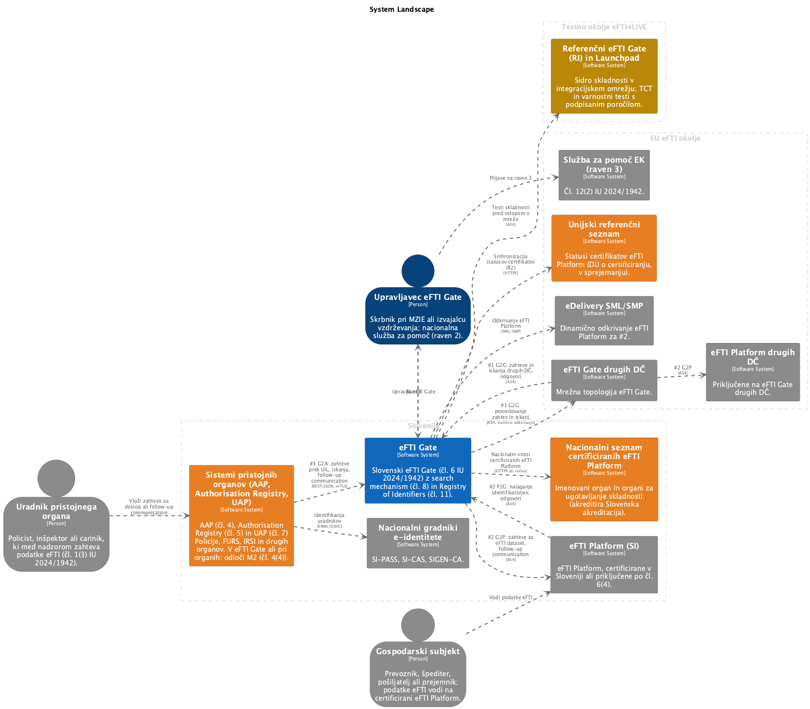

## D.2 Kontekst (C1)

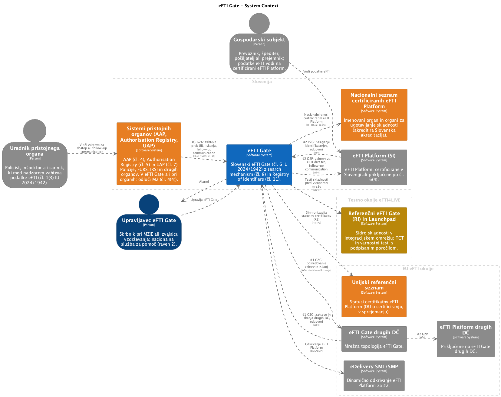

Vmesniki po ICD v0.5 §3.1 (osnutek): **#1 G2G** in **#2 G2P** sta normativna na ravni EU; **#3 G2A** (eFTI Gate–organi) je nacionalna izbira in ga določa ta TS (pogl. 7.5).

## D.3 Vsebniki (C2)

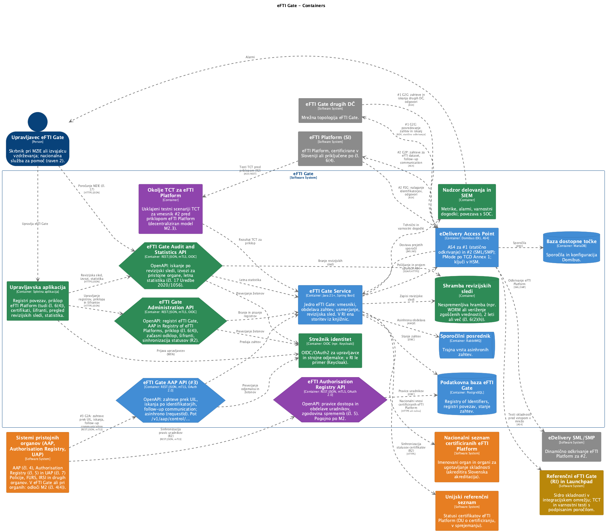

| Vsebnik | V RI | Kaj zahteva TS |
|---|---|---|
| eFTI Gate Service (Spring Boot) | da, ena storitev iz knjižnic | horizontalno skaliranje, visoka razpoložljivost (8.1, 8.8) |
| API za pristojne organe (#3) | da | specifikacija OpenAPI, mTLS (7.5, 8.2) |
| eDelivery Access Point (Domibus + MariaDB) | da | produkcijska PKI, ključi v HSM, SML/SMP (6.8, 6.9, 8.5.2) |
| Podatkovna baza (PostgreSQL) | da | varnostne kopije, RTO/RPO (8.1) |
| Sporočilni posrednik (RabbitMQ) | da | trajna vrsta (8.4) |
| Strežnik identitet (OIDC) | le primer (Keycloak) | MFA za upravljavce, odjemalci AAP (7.3, 8.5.3) |
| Upravljavska aplikacija | ne | registri povezav, priklop eFTI Platform, čl. 6(4), statistika (7.6) |
| Shramba revizijskih sledi | delno (dnevniki v datotekah) | nespremenljiva hramba, 2 leti ali več (6.5, 8.5.4) |
| Nadzor delovanja in SIEM | izven obsega RI | metrike, alarmi, SOC (8.4, 8.5.4) |
| Okolje TCT za eFTI Platform | ne | R2; decentraliziran TCT (9.7) |

## D.3a Storitve OpenAPI (C2-API)

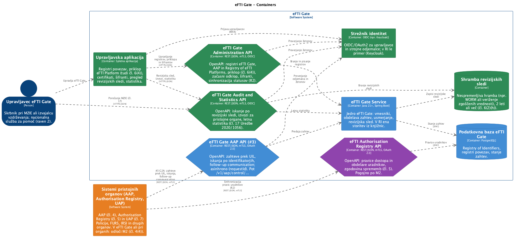

Storitve OpenAPI so v modelu vsebniki z oznako API (šesterokotnik) in lastnostjo `openapi`, ki kaže na specifikacijo. Pregled operacij je v Prilogi E, zahteve v pogl. 7.9.

| Element | Storitev | Specifikacija | Izdaja |
|---|---|---|---|
| `gate.aapApi` | eFTI Gate AAP API (#3) | `interfaces/openapi/efti-gate-aap-api.yaml` | R1 |
| `gate.adminApi` | eFTI Gate Administration API | `interfaces/openapi/efti-gate-admin-api.yaml` | R1 |
| `gate.auditApi` | eFTI Gate Audit and Statistics API | `interfaces/openapi/efti-gate-audit-api.yaml` | R1 |
| `gate.arApi` | eFTI Authorisation Registry API | `interfaces/openapi/efti-authorisation-registry-api.yaml` | R2, pogojno |

## D.3b Namestitev produkcijskega okolja

Pregled obeh lokacij (cone, HSM, replikacija) in podrobna namestitev ene lokacije; rezervna lokacija je enaka. Viri in lastnosti so v pogl. 5.5; varianta gostovanja (H1 DRO, H2 co-location, H3 IaaS) se izbere ob M2.

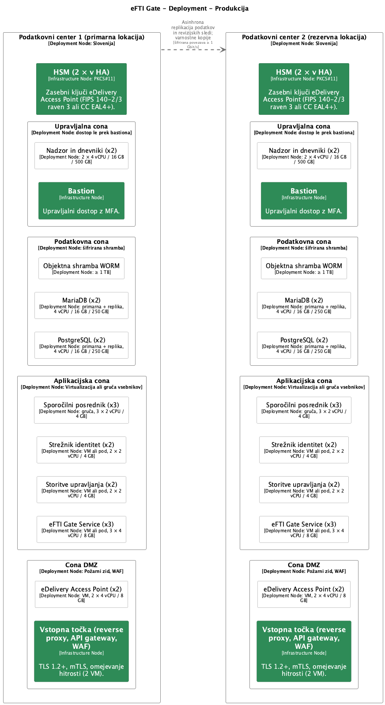

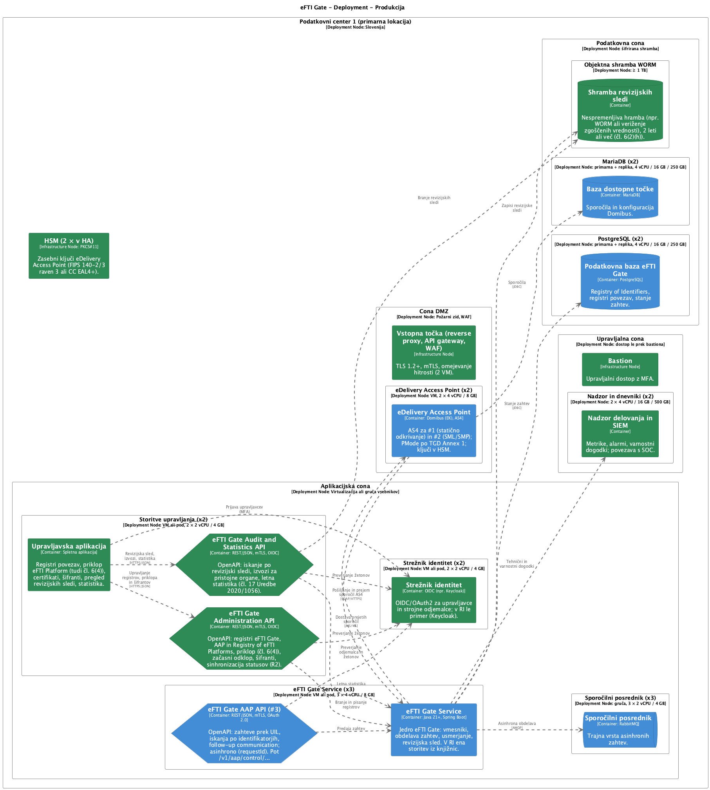

## D.4 Komponente eFTI Gate Service (C3)

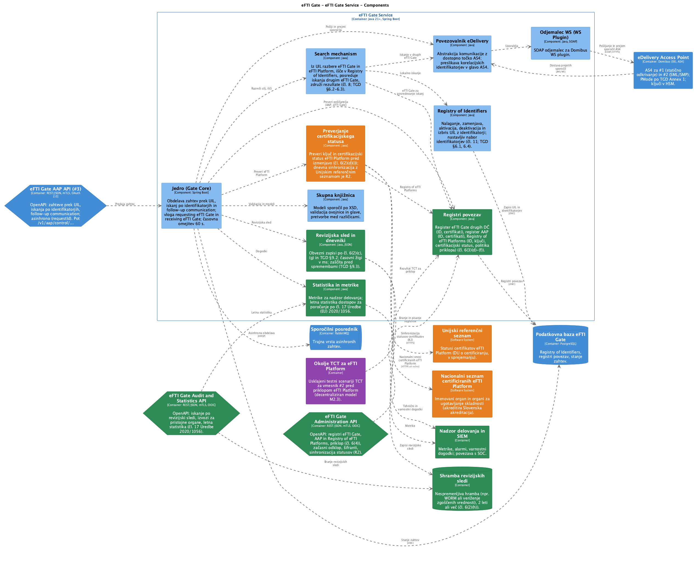

## D.5 Dinamični pogledi

### D1 Dostop prek UIL, eFTI Platform na slovenskem eFTI Gate (PU-CA-1, PU-G2P-1)

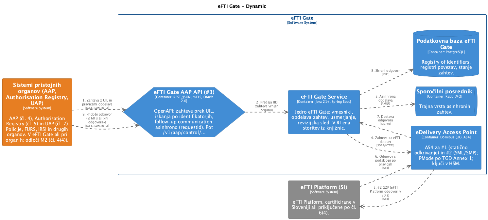

Časovne omejitve (ICD v0.5 §10, osnutek): eFTI Platform odgovori v 50 s, odgovorni eFTI Gate v 60 s (zakonska meja, čl. 6(2)(f)), requesting eFTI Gate čaka 65 s.

### D2 Dostop prek UIL, eFTI Platform na tujem eFTI Gate (PU-CA-1, PU-G2G-1)

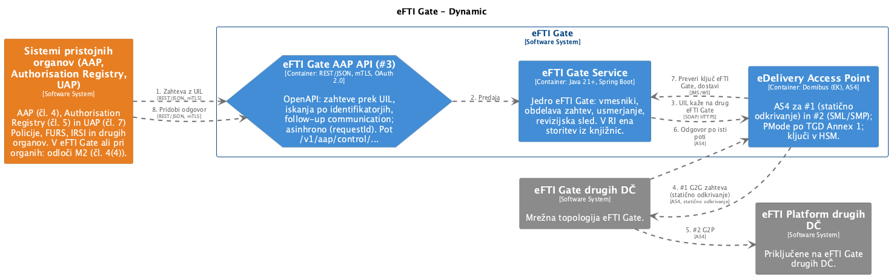

### D3 Iskanje po identifikatorjih (PU-CA-2/3, PU-G2G-3)

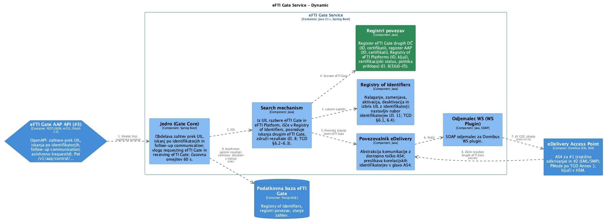

### D4 Nalaganje in deaktivacija identifikatorjev (PU-P2G-1/2)

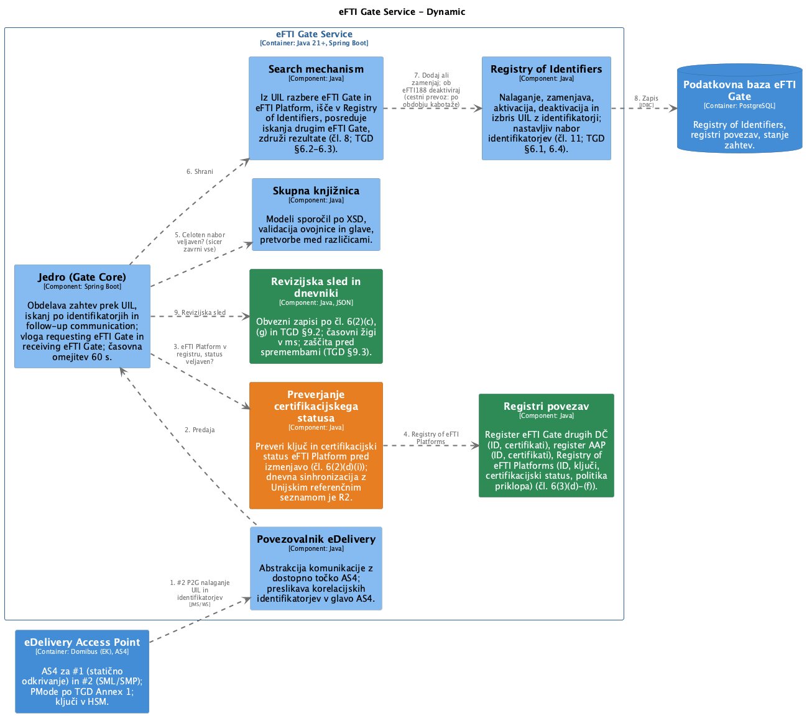

### D5 follow-up communication (PU-CA-4, PU-G2P-2)

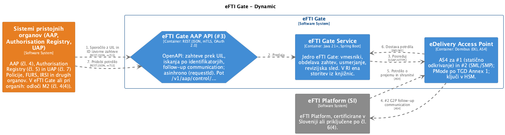

## D.6 Odprto (po M2)

- Razdelitev sistema `authorities` na AAP, Authorisation Registry in UAP ter njihova umestitev (v eFTI Gate ali pri organih, čl. 4(4)).
- Pogled namestitve je osnutek (D.3b); dokončen po izbiri variante gostovanja v M2.
- Preverjanje certifikacijskega statusa: lokalna kopija Unijskega referenčnega seznama ali SMP (TGD §8.3, možnost b) – odvisno od delegiranega akta.
- Profil REST za #2 kot nacionalna možnost (čl. 9(4)).
