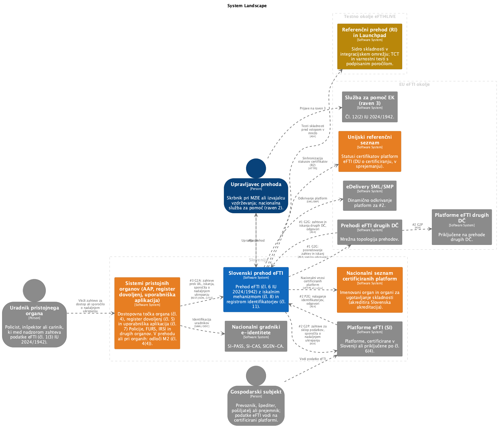
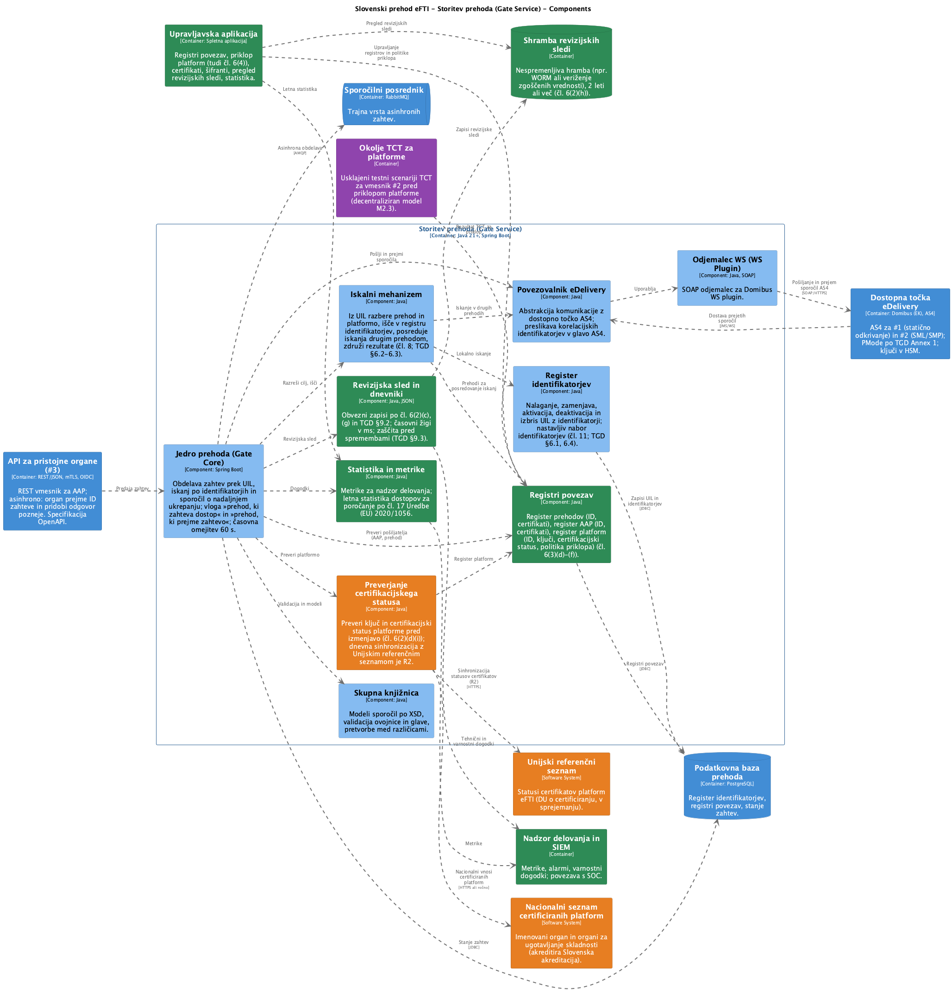
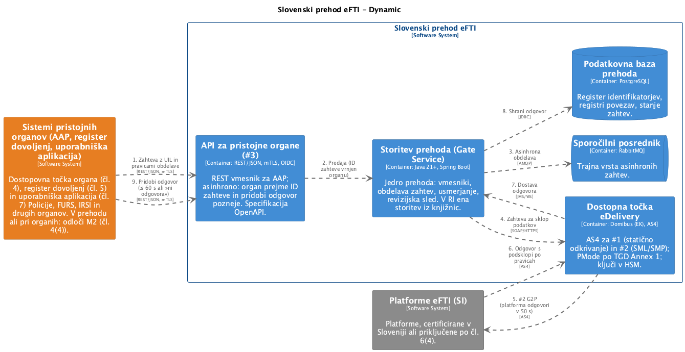
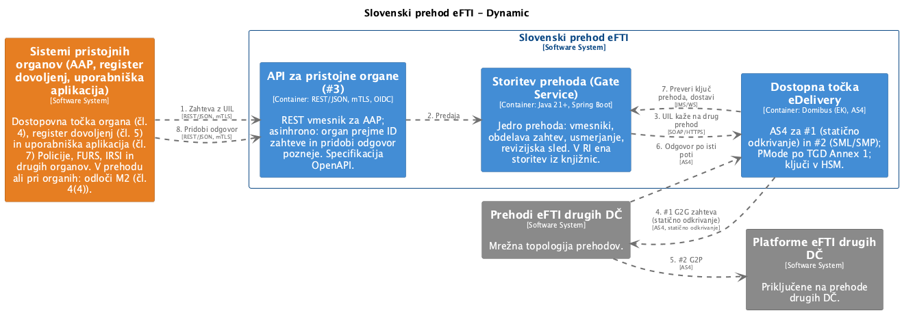
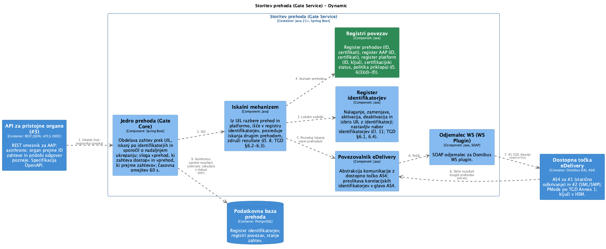
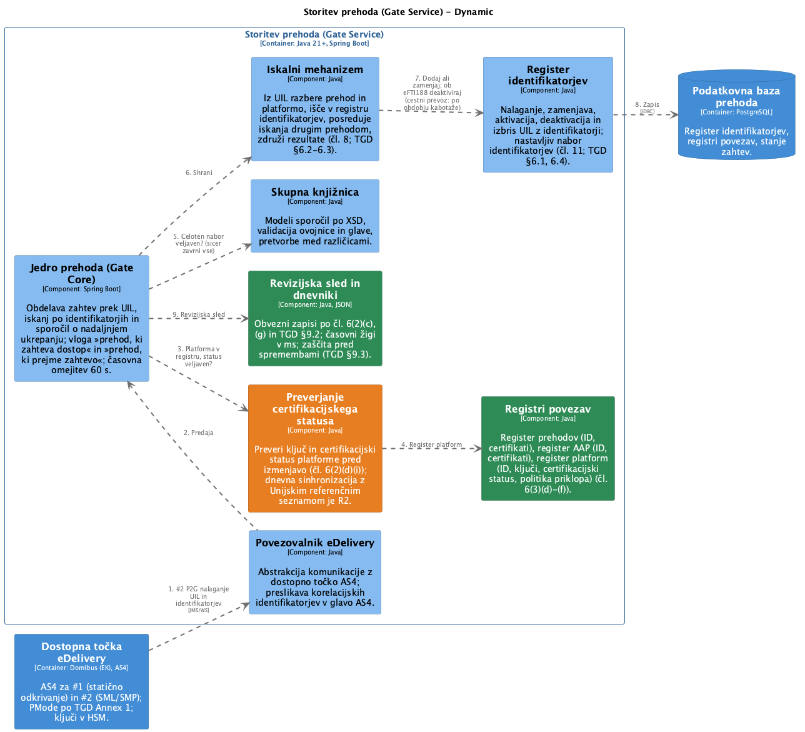
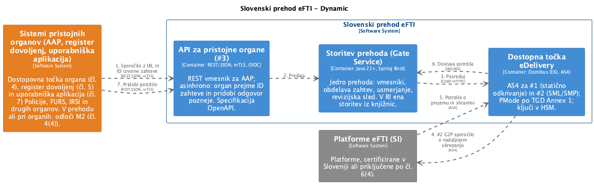

# Priloga D: Referenčna arhitektura in diagrami

> **Status:** model C4 v0.2 (19. 11. 2026); umestitev AAP, registra dovoljenj in uporabniške aplikacije ter pogled namestitve sta odvisna od M2
>
> **Vir resnice:** [`architecture/workspace.dsl`](../../architecture/workspace.dsl) (Structurizr DSL). Diagramov ne urejamo ročno; osvežimo jih s `scripts/render-diagrams.sh`.

Arhitektura je opisana po modelu C4: pokrajina (C0), kontekst (C1), vsebniki (C2), komponente (C3) in dinamični pogledi (D1–D5) za primere uporabe iz pogl. 7. Izhodišče za C2 in C3 je referenčna implementacija prehoda eFTI (RI), glej [ADR-0002](../adr/0002-referencna-implementacija-kot-izhodisce.md).

## D.0 Legenda

| Barva | Oznaka v modelu | Pomen |
|---|---|---|
| modra | RI | element obstaja v referenčni implementaciji |
| zelena | Dodatek SI | ni v RI ali ga je za produkcijo treba bistveno razširiti |
| oranžna | Odprto | umestitev ali obseg še ni odločen (M2, delegirani akt o certificiranju) |
| vijolična | R2 | predvideno v izdaji R2 (pogl. 10.5); vsi drugi elementi so v R1 |
| siva | Zunanji | zunanji sistem ali oseba |
| zlata | Test | testno okolje eFTI4LIVE |

Element ima lahko več oznak; barva ustreza zadnji (npr. okolje TCT: Dodatek SI, Odprto, R2 → vijolična). Vsak diagram ima ob sebi legendo, ki jo ustvari izvoznik (`*-key.png`).

**Povezava z zahtevami.** Stolpec Komp. v pogl. 6–10 se preslika v elemente modela; Priloga C ima zato stolpec »Element C4«.

| Komp. | Element v modelu |
|---|---|
| PE | `vrata.gateService` (storitev prehoda) |
| IM | `vrata.gateService.iskalnik` |
| RID | `vrata.gateService.roi` |
| ED | `vrata.ap` (dostopna točka eDelivery) |
| AAP, RD, UA | `organi` (do odločitve M2 en sistem) |
| UP | `vrata.admin` |
| OP | — (obratovanje in organizacija; ni elementa modela) |
| TCT | `vrata.tct` (okolje TCT za platforme) |

## D.1 Pokrajina (C0)

## D.2 Kontekst (C1)

Vmesniki po ICD v0.5 §3.1 (osnutek): **#1 G2G** in **#2 G2P** sta normativna na ravni EU; **#3 G2A** (prehod–organi) je nacionalna izbira in ga določa ta TS (pogl. 7.5).

## D.3 Vsebniki (C2)

| Vsebnik | V RI | Kaj zahteva TS |
|---|---|---|
| Storitev prehoda (Spring Boot) | da, ena storitev iz knjižnic | horizontalno skaliranje, visoka razpoložljivost (8.1, 8.8) |
| API za pristojne organe (#3) | da | specifikacija OpenAPI, mTLS (7.5, 8.2) |
| Dostopna točka eDelivery (Domibus + MariaDB) | da | produkcijska PKI, ključi v HSM, SML/SMP (6.8, 6.9, 8.5.2) |
| Podatkovna baza (PostgreSQL) | da | varnostne kopije, RTO/RPO (8.1) |
| Sporočilni posrednik (RabbitMQ) | da | trajna vrsta (8.4) |
| Strežnik identitet (OIDC) | le primer (Keycloak) | MFA za upravljavce, odjemalci AAP (7.3, 8.5.3) |
| Upravljavska aplikacija | ne | registri povezav, priklop platform, čl. 6(4), statistika (7.6) |
| Shramba revizijskih sledi | delno (dnevniki v datotekah) | nespremenljiva hramba, 2 leti ali več (6.5, 8.5.4) |
| Nadzor delovanja in SIEM | izven obsega RI | metrike, alarmi, SOC (8.4, 8.5.4) |
| Okolje TCT za platforme | ne | R2; decentraliziran TCT (9.7) |

## D.4 Komponente storitve prehoda (C3)

## D.5 Dinamični pogledi

### D1 Dostop prek UIL, platforma na slovenskem prehodu (PU-CA-1, PU-G2P-1)

Časovne omejitve (ICD v0.5 §10, osnutek): platforma odgovori v 50 s, odgovorni prehod v 60 s (zakonska meja, čl. 6(2)(f)), prehod, ki zahteva dostop, čaka 65 s.

### D2 Dostop prek UIL, platforma na tujem prehodu (PU-CA-1, PU-G2G-1)

### D3 Iskanje po identifikatorjih (PU-CA-2/3, PU-G2G-3)

### D4 Nalaganje in deaktivacija identifikatorjev (PU-P2G-1/2)

### D5 Sporočilo o nadaljnjem ukrepanju (PU-CA-4, PU-G2P-2)

## D.6 Odprto (po M2)

- Razdelitev sistema `organi` na AAP, register dovoljenj in uporabniško aplikacijo ter njihova umestitev (v prehodu ali pri organih, čl. 4(4)).
- Pogled namestitve (deployment): gostovanje, okolja (pogl. 9.2), cone omrežja, HSM.
- Preverjanje certifikacijskega statusa: lokalna kopija Unijskega referenčnega seznama ali SMP (TGD §8.3, možnost b) – odvisno od delegiranega akta.
- Profil REST za #2 kot nacionalna možnost (čl. 9(4)).
