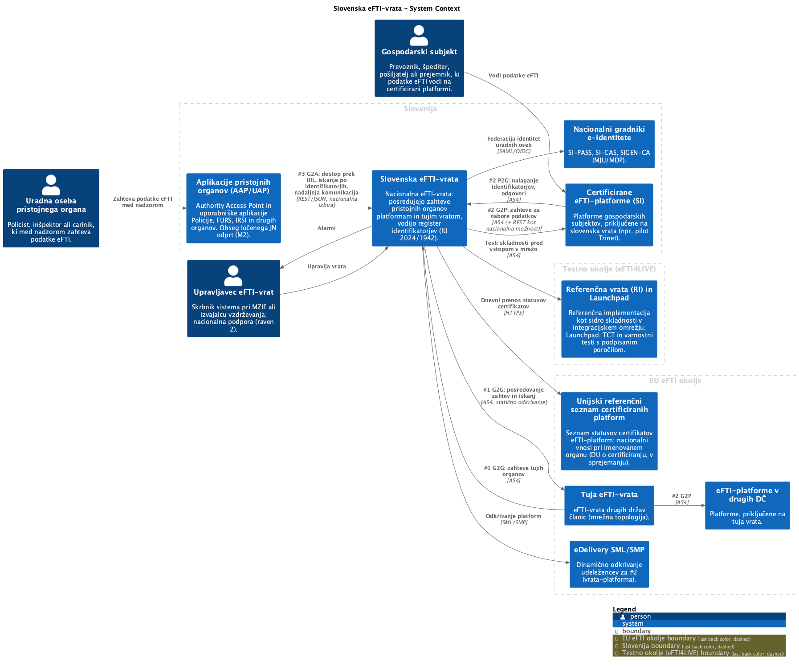
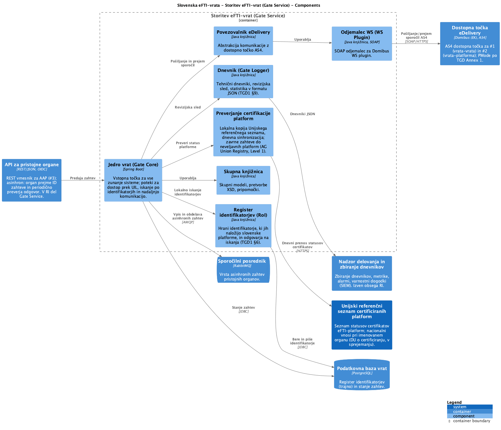
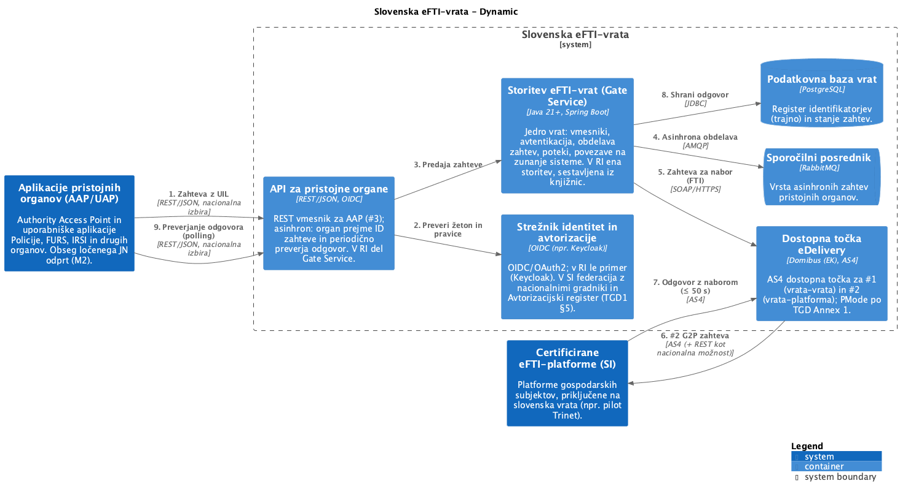

# Priloga D: Referenčna arhitektura in diagrami

> **Status:** osnutek modela C4 (19. 11. 2026); odvisno od izbire variante v M2
>
> **Vir resnice:** [`architecture/workspace.dsl`](../../architecture/workspace.dsl) (Structurizr DSL). Diagramov ne urejamo ročno; osvežimo jih s `scripts/render-diagrams.sh`.

Arhitektura je opisana po modelu C4 (kontekst, vsebniki, komponente, dinamični pogledi). Izhodišče za ravni 2 in 3 je referenčna implementacija eFTI-vrat projektov eFTI4EU/eFTI4LIVE (TG2.2), glej [ADR-0002](../adr/0002-referencna-implementacija-kot-izhodisce.md).

Legenda oznak v modelu:

| Oznaka | Pomen |
|---|---|
| RI | element obstaja v referenčni implementaciji |
| Dodatek SI | ni v RI; zahteva ga produkcijska uporaba ali slovenski kontekst |
| Odprto | umestitev ali obseg še ni odločen (M2 ali EU specifikacije) |

## D.1 Raven 1: kontekst

Vmesniki so označeni po ICD v0.5 §3.1: **#1 G2G** in **#2 G2P** sta normativna (harmonizirana na ravni EU), **#3 G2A** (vrata–AAP) je nacionalna izbira in ga določa ta TS.

## D.2 Raven 2: vsebniki

| Vsebnik | V RI | Kaj mora dodati slovenska TS |
|---|---|---|
| Storitev eFTI-vrat (Spring Boot) | da, ena storitev iz knjižnic | horizontalno skaliranje, visoka razpoložljivost |
| Dostopna točka eDelivery (Domibus + MariaDB) | da | produkcijska PKI, SML/SMP |
| Podatkovna baza (PostgreSQL) | da | varnostne kopije, roki hrambe |
| Sporočilni posrednik (RabbitMQ) | da | — |
| Strežnik identitet (OIDC) | le primer (Keycloak) | SI-PASS/SI-CAS/SIGEN-CA, Avtorizacijski register |
| Upravljavska aplikacija | ne | celotna |
| Nadzor delovanja in dnevniki | izven obsega RI | SIEM, metrike, alarmi |

## D.3 Raven 3: komponente storitve eFTI-vrat

## D.4 Dinamični pogled: UC1 dostop prek UIL

Časovne omejitve po ICD v0.5 §10: platforma odgovori v 50 s, odgovorna vrata v 60 s (zakonska meja), vrata, ki zahtevo pošljejo, čakajo 65 s.

## D.5 Odprta vprašanja

- Umestitev Avtorizacijskega registra (vrata ali AAP), TGD1 §5.
- Obseg AAP/UAP v ločenem JN (M2).
- Preverjanje certifikacije platform: lokalna kopija Unijskega referenčnega seznama (predlog AG Union Registry) ali sprotno preverjanje (izvirni koncept EK).
- REST za #2 kot nacionalna možnost (ICD P-02).
- Pogled namestitve (deployment) po izbiri variante gostovanja v M2.
